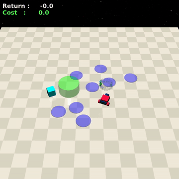
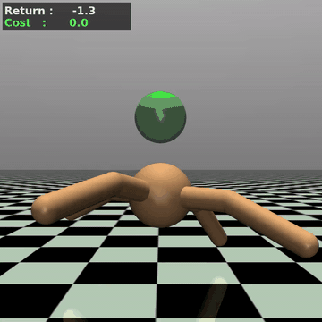
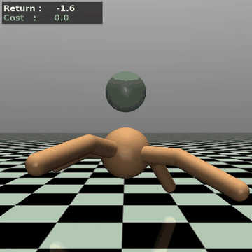

# UCP
Utility-constrained Policies

This implementation builds on research code from [meta-pytorch/LeanRL](https://github.com/meta-pytorch/LeanRL).

## Environment Setup
- `conda env create -f conda-recipe.yaml`
- `conda activate UCP`

## Running the Code
- Launch training with `python ucp.py` plus any CLI flags.
- Environment-specific YAML config files in `configs/` can provide defaults. CLI arguments override YAML values, and missing config files fall back to the dataclass defaults in `ucp.py`.

## `ucp.py`
- Implements the current UCP training loop with distributional reward and cost critics, SAC-style policy updates, and a Lagrangian safety constraint.
- Uses TorchRL's `MultiStepTransform` for configurable n-step returns.
- Supports cost-stock observation augmentation through `AugmentedObservation`.
- Supports sampled initial cost stocks with a binned contextual Lagrangian, where each cost-budget bin has its own learned multiplier.
- Supports TensorBoard/W&B logging, periodic checkpoint saving, evaluation, `torch.compile`, and CUDA graph capture.

Example:
```bash
python ucp.py --env-id SafetyCarGoal1-v0 # UCP
python ucp.py --env-id SafetyCarGoal1-v0 --no-add-cost-stock # UCP-NA 
```

## Learned Policies Under Different Budgets

Each row shows the **same trained policy**, evaluated with an initial cost budget of 0 (left) and 25 (right).

We analyzed and visualized the learned policies under different budgets. For **Navigation**, larger budgets lead to more direct paths through costly regions and faster goal completion. For **Velocity**, agents with a positive budget tend to spend it early and then switch to safer velocities, whereas zero-budget agents adopt the safe behavior from the start.

### SafetyCarGoal1-v0 (Navigation)
With CarGoal, the higher budget achieved a **higher return** at a **higher cost**.

| Budget = 0 | Budget = 25 |
|:---:|:---:|
|  |  |
| Return: 25.31 · Cost: 0.00 ([mp4](videos/cargoal_budget0.mp4)) | Return: 32.65 · Cost: 19.00 ([mp4](videos/cargoal_budget25.mp4)) |

### SafetyAntVelocity-v1 (Velocity)
With Ant, the higher budget achieved a **lower return** at a **higher cost**.

| Budget = 0 | Budget = 25 |
|:---:|:---:|
|  |  |
| Return: 3250.27 · Cost: 1.00 ([mp4](videos/antvelocity_budget0.mp4)) | Return: 3146.82 · Cost: 26.00 ([mp4](videos/antvelocity_budget25.mp4)) |


## License

This project includes code derived from LeanRL:
https://github.com/meta-pytorch/LeanRL

Specifically:
- sac_continuous_action_torchcompile.py

LeanRL is licensed under the MIT License.

Modifications and additional code:
Copyright 2026 Mehrdad Moghimi
Licensed under the Apache License, Version 2.0.